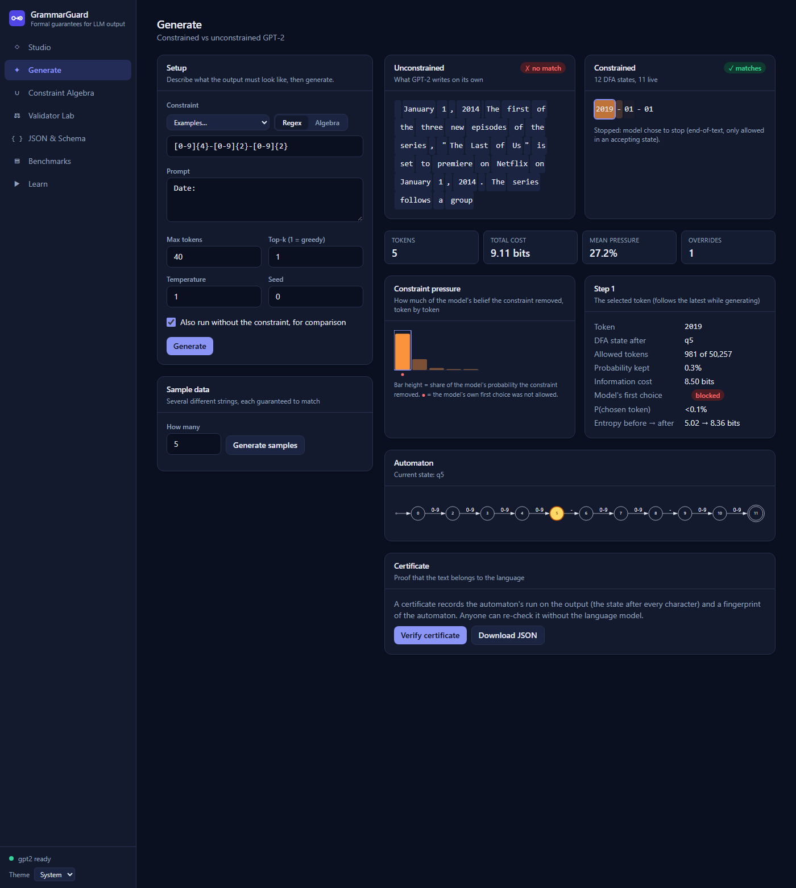
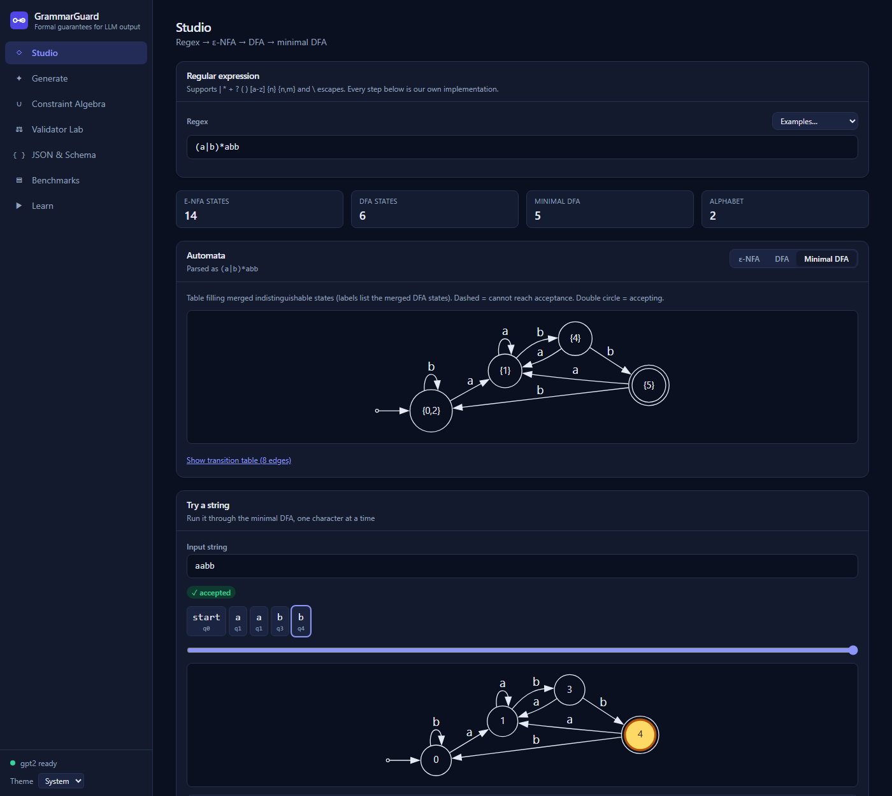
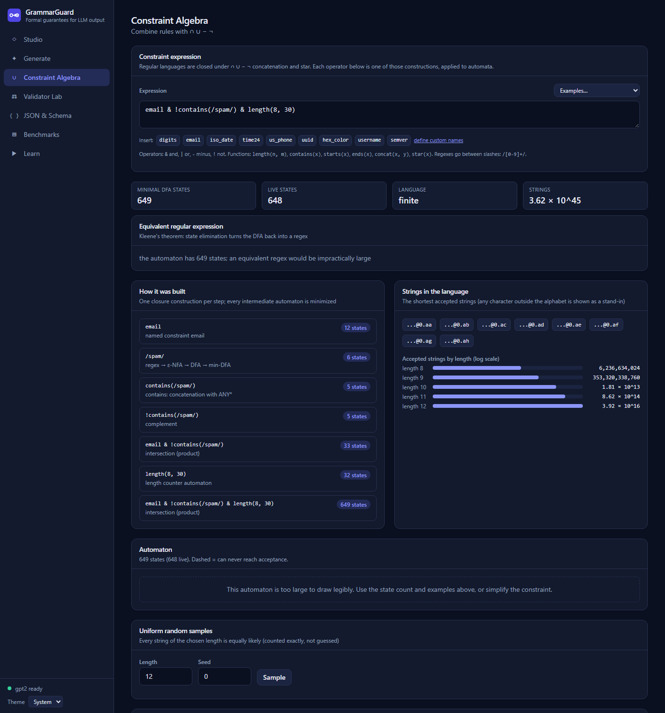
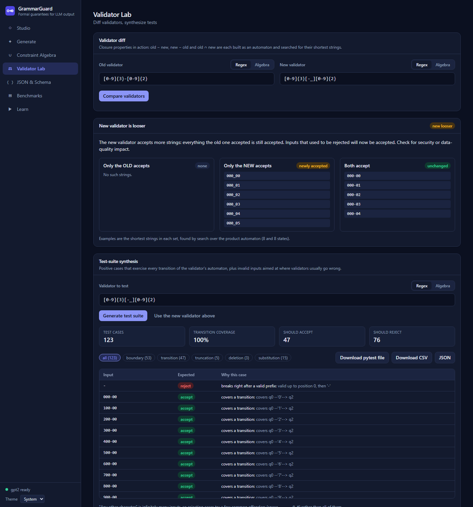
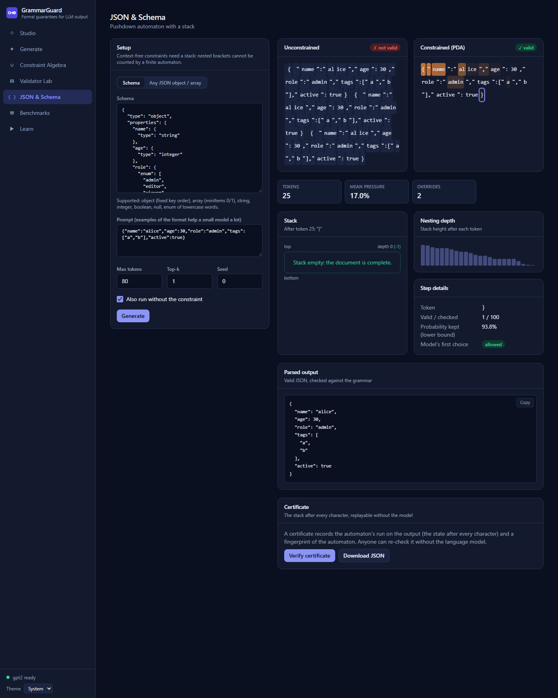

# GrammarGuard

**Formal guarantees for LLM output, and formal QA for the validators behind them.**

A Theory of Computation project. Give it a regex, a combination of rules, or a JSON schema, and GPT-2 can only produce text that
matches: at every step, tokens that would make a match impossible are removed *before* the model chooses. The automata (regex parser,
ε-NFA, DFA, minimization, product construction, state elimination, LL(1) tables, pushdown automaton) are **implemented from scratch with
only the Python standard library**, with no automata libraries and no `re` in the core.



## What you can do with it

* **Generate with a guarantee.** Watch unconstrained GPT-2 next to constrained output, token by token, with the DFA state, the number of
  allowed tokens, and a per-token **constraint pressure** (how much of the model's belief the constraint removed, in bits).
* **Combine rules with closure properties.** `email & !contains(/spam/) & length(8, 30)`: every operator is a product, complement or
  concatenation construction; you see each step and the minimal automaton.
* **Diff two validators.** "Does my new form regex accept anything the old one rejected?" Answered with *shortest counterexample* strings.
* **Synthesize a test suite** for a validator: positive cases covering every automaton transition, plus boundary, substitution, deletion and
  truncation negatives. Download it as a ready-to-run pytest file.
* **Count and sample a language exactly**, and turn any automaton back into a regex (Kleene's theorem).
* **Check a certificate.** Every generation ships with the automaton's run on the output and a fingerprint; anyone can re-verify it
  *without the model*.
* **Constrain JSON with a pushdown automaton**, optionally guided by a schema, and watch the stack grow and shrink.
* **Learn.** Step through subset construction and table-filling minimization as they run on your own regex.

| | |
|---|---|
|  |  |
|  |  |

## Quick start

**Docker** (one command; includes the model, so it starts offline):

```bash
docker compose up --build        # then open http://localhost:8000
```

**Local** (Python 3.11, Node 20+ for the UI):

```bash
python3.11 -m venv .venv && source .venv/bin/activate
pip install torch --index-url https://download.pytorch.org/whl/cpu    # CPU-only torch (smaller)
pip install -e ".[ml,api,dev]"                                         # or: make install
make web-install                                                       # frontend dependencies
make serve                                                             # builds the UI, serves API + UI on :8000
```

The first run downloads GPT-2 (~500 MB). For development run `make api` (backend with reload) and `make web` (Vite on :5173,
proxies `/api`) in two terminals.

**Command line:**

```bash
python -m grammarguard.cli --regex "[0-9]{4}-[0-9]{2}-[0-9]{2}" --prompt "Date: " --verbose
```

**API:** interactive docs at `/docs`; reference with examples in [docs/API.md](docs/API.md).

```bash
curl -s localhost:8000/api/v1/equivalence -H 'content-type: application/json' \
  -d '{"a": {"text": "(a|b)*abb"}, "b": {"text": "(a|b)*bb"}}'
# {"equivalent":false,"counterexample":"bb","accepted_by_a":false,"accepted_by_b":true,...}
```

<!-- BENCHMARK:START -->
## Results

Measured on 288 runs over 18 validators (dates, phone numbers, IDs, emails, numbers, and combined
policies), each with a bare prompt and a few-shot prompt, greedy and sampled decoding, GPT-2 on CPU (12 cores),
2026-10-28. Intervals are 95% Wilson confidence intervals; "n" per row is 108 runs (retries: 72).

| Method | Output satisfies the validator |
|---|---|
| Unconstrained GPT-2, as is | 0% (0–3) |
| Unconstrained + extract a valid prefix | 11% (6–18) |
| Best-of-5 retries, as is | 3% (1–10) |
| Best-of-5 retries + extract a valid prefix | 17% (10–27) |
| **GrammarGuard (DFA-constrained)** | **100% (97–100)** |

*"As is" means the whole output must match, as a real validator would require. "Extract a valid prefix" is the most a post-processing
step could achieve: a run counts if **any** non-empty prefix of the output matches.*

* **Constrained decoding was valid in every run** (108/108). All 224 regex outputs were also judged by
  Python's `re.fullmatch`, which agreed with our DFA on every one (0 disagreements).
* **GPT-2 on its own almost never produces the format.** 104 of 108 unconstrained runs ran to the token limit instead of
  stopping where the format ends. Even rescuing a valid prefix from the output gets only 11% (6–18); best-of-5 retries
  with extraction gets 17% (10–27). A single unconstrained attempt never produced a valid prefix, even with extraction, for dates, numbers or phones.
  It does best on emails and policies, where list-like prompts invite the right shape.
* **What the guarantee costs.** The constraint adds on average **16.9 bits** per output (the information it injects:
  −log₂ of the probability GPT-2 itself gave the allowed tokens) with 2.8 overrides of the model's first choice per output.
  Per token, constrained decoding takes **1.34×** the time of plain decoding (mask and telemetry), excluding the one-off
  token-index build (milliseconds for ordinary validators; a 649-state email policy uses a lazy index instead of the
  7.5 s full build).
* **Honest caveats.** This is a *small* model: a larger model would need the constraint less often, and would likely do better in the
  baselines, so read the gap as "GPT-2 cannot be trusted with these formats", not as a universal figure. 3 constrained runs
  stopped at the token limit rather than at end-of-text; all were the open-ended `decimal` regex, where the text is a genuinely valid
  number but repetitive (`333333…`). The benchmark was first run with prompts that ended mid-item (`EMP-`) and a retry baseline without
  prefix credit; both were unfair to the baselines, so they were fixed and everything rerun (see DECISIONS.md).

Every run, including the text it produced, is stored in [`eval/results/latest.json`](eval/results/latest.json), shown in the
**Benchmarks** page with a run explorer, and summarised in [`eval/results/latest.md`](eval/results/latest.md). Re-run with
`python -m grammarguard.eval` (about 8 minutes on CPU; `--quick` for a one-minute subset).

<!-- BENCHMARK:END -->

## How it works

```
regex ─parse─▶ AST ─Thompson─▶ ε-NFA ─subset construction─▶ DFA ─minimize─▶ minimal DFA
                                                                                │
GPT-2 vocabulary ── run the DFA over each token's characters (trie, pruned) ────┤
                                                                                ▼
                       token index: allowed[q], next[q][t]   (lazy for big DFAs, cached on disk)
                                                                                │
         logits ─mask tokens outside allowed[q] (EOS only if q accepting)─▶ pick ─▶ advance q
```

A model emits multi-character *tokens* while a DFA reads *characters*. For each live DFA state q (one from which an accepting state is
reachable) and each token t, we run the DFA over t. If it ends in a live state, t is allowed in q. Allowed tokens can never lead to a
dead end, so when generation stops with end-of-text, which is allowed only in accepting states, the output is a string of the language.
The full argument, with the trie speed-up, the lazy index, the PDA variant and the pressure/KL identity, is in
[docs/THEORY.md](docs/THEORY.md).

### File → syllabus topic

| File | Syllabus topic |
|---|---|
| `grammarguard/core/regex_parser.py` | Regular expressions; union, concatenation and star as the only primitives; `+ ? {n,m}` and classes as syntactic sugar; tokenizer + recursive-descent parser |
| `grammarguard/core/nfa.py` | **ε-NFA**, Thompson's construction, **ε-closure**, NFA simulation |
| `grammarguard/core/dfa.py` | **Subset construction**; **DFA** and δ\*; the dead state and the `OTHER` symbol; **minimization** (table filling = Myhill–Nerode, and Moore partition refinement); live states and emptiness; **closure under** ∩ ∪ − △ (product), complement, concatenation, star; **equivalence** with a shortest counterexample |
| `grammarguard/core/elimination.py` | **Kleene's theorem**: DFA → regex by state elimination |
| `grammarguard/core/algebra.py` | Closure properties as a language: constraint expressions evaluated with product / complement / NFA constructions |
| `grammarguard/core/counting.py` | Decision procedures (finiteness, emptiness); counting strings by dynamic programming; exact uniform sampling |
| `grammarguard/core/testgen.py` | Graph-coverage test generation from a DFA |
| `grammarguard/core/cfg.py` | **Context-free grammars**, nullable / **FIRST** / **FOLLOW**, **LL(1)** parse table and conflict detection |
| `grammarguard/core/pda.py` | **Deterministic pushdown automaton** (stack, expand/match moves, acceptance by empty stack) |
| `grammarguard/core/schema.py` | Grammar construction from a specification; left-factoring |
| `grammarguard/core/certificate.py` | Verifiable membership proofs: automaton runs, fingerprints |
| `grammarguard/decoding/` | Applying automata to token strings; trie × DFA product; constrained generation loops; constraint pressure |
| `grammarguard/api/`, `frontend/` | FastAPI service and React app |
| `grammarguard/eval/` | Benchmark harness with confidence intervals |

**New to the subject?** [docs/DEMO.md](docs/DEMO.md) teaches the background in plain words and gives a step-by-step demonstration
script with exact inputs, expected results and screenshots.
Design decisions and simplifications are recorded in [DECISIONS.md](DECISIONS.md); likely viva questions with short answers are in
[docs/VIVA.md](docs/VIVA.md).

### Supported regex syntax

Literals, `|`, concatenation, `*`, `+`, `?`, `( )`, classes like `[0-9]` / `[a-z_]`, `{n}`, `{n,m}`, `{n,}`, and `\x` to escape a
special character. Not supported: `.`, `^`, `$`, `[^…]`, and shorthands such as `\d` (see DECISIONS.md for why).

## Repository layout

```
grammarguard/
  core/        regex → NFA → DFA, minimization, closure, elimination, counting, testgen, CFG, PDA   (standard library only)
  decoding/    token index (trie, lazy), generation loops, telemetry, engine (model, lock, cancellation)
  api/         FastAPI app: routers, schemas, limits, SSE streaming
  eval/        benchmark suite, runner, statistics, report
frontend/      React + TypeScript + Vite + Tailwind (served by the API in production)
tests/         unit, property-based (Hypothesis), API (with a fake engine), and real-GPT-2 tests
docs/          THEORY.md, API.md, VIVA.md
eval/results/  latest benchmark results (JSON + Markdown)
```

## Quality

```bash
make test-fast     # everything that does not load GPT-2
make test          # the full suite (loads GPT-2 on CPU)
make lint typecheck web-test
python -m grammarguard.eval          # regenerate the benchmark (about 8 minutes on CPU)
```

* Python tests compare our NFA/DFA/minimal DFA with Python's `re.fullmatch` and the JSON PDA with `json.loads` on random strings
  (Hypothesis), and check algebraic laws by brute force.
* `mypy` runs on the whole `core` package; `ruff` on everything; the frontend is strict TypeScript, with request/response types generated
  from the backend's OpenAPI schema so the two cannot drift.
* CI (`.github/workflows/ci.yml`) runs the fast Python tests and the frontend type-check, tests and build.

## Limitations and future work

* The model is GPT-2: the *format* of the output is guaranteed, the *content* is only as good as a small model.
* The JSON subset is compact (no whitespace), strings are lowercase, and there are no negative numbers or escapes. The regex dialect has
  no wildcard or negated classes.
* "Any other character" is infinitely many inputs, so generated negative tests try a few common offenders only. After a top-100 check the
  PDA's probability-mass figure is a lower bound.
* The Docker image has not been built in the development environment (Docker was not available there); the Dockerfile and compose file
  are written and their `COPY` sources checked.
* Not built: Chomsky / Greibach normal forms, CYK parsing, pumping-lemma tooling, linear bounded automata, the Post correspondence
  problem, nondeterministic PDAs and Turing machines. The grammar is used directly in LL(1) form, so only deterministic context-free
  languages are supported.
