# GrammarGuard: demo guide for someone new to the subject

This guide assumes **you do not know Theory of Computation**. It first teaches you just enough to explain the project,
then gives a step-by-step demonstration you can run in front of a teacher, with the exact things to type, what you will
see (with screenshots), and what to say. Every number in it was measured on the real system; the screenshots are the real
application (shown in dark theme because that was the computer's setting).

**How to read it**

| If you have... | Read |
|---|---|
| 30 minutes before the demo | Part 1 (the subject in plain words), Part 2 (checklist), then rehearse Part 3 once |
| 10 minutes | The "one-page summary" below and the "10-minute plan" in Part 4 |
| Time to prepare properly | Everything, then also `docs/VIVA.md` (35 likely questions) |

---

## The one-page summary (memorise this)

**The problem.** AI language models (like GPT-2) write text one small piece at a time, guessing what comes next. Ask one for a
date and it may write "January 1st, 2014" or a paragraph about something else. Programs that need a *specific format* (a date like
`2024-05-17`, a phone number, an ID, valid JSON) cannot trust it.

**The idea.** Describe the allowed format as a *rule*. Turn the rule into a small **state machine** (a map of rooms and doors where
every letter is a door). Before the model picks its next piece of text, **remove every option that would make the format impossible**.
What is left can only lead to a valid answer. So the final answer is *guaranteed* to match.

**What makes it a Theory of Computation project.** Everything that turns a rule into a machine is **written by hand**, using the
algorithms from the course: regular expressions, NFAs, DFAs, subset construction, minimization, closure properties, equivalence,
and a pushdown automaton (a state machine with a stack) for nested structures like JSON. No library does this for us.

**What it adds beyond "just constrain the AI":**
1. Combine rules with *and / or / not* and see the machine being built (`Constraint Algebra`).
2. Compare two versions of a rule and get *proof strings* showing the difference (`Validator Lab`).
3. Generate a test suite for any rule automatically.
4. Count the valid strings exactly and pick random valid ones fairly.
5. Hand over a *certificate* that anyone can re-check without the AI.
6. Measure how hard the rule had to push against the AI, in *bits*.
7. A benchmark: 288 runs on 18 realistic formats. Plain GPT-2: valid **0%** of the time (11% with a rescue trick). With GrammarGuard: **100%**.

---

## Part 1: The subject in plain words

### 1.1 Words you will use

| Word | Plain meaning | Tiny example |
|---|---|---|
| **Language model / GPT-2** | A program that continues text by repeatedly guessing the next small piece. GPT-2 is a small, older one that runs on an ordinary computer. | You type `Date: `, it continues `January 1, 2014...` |
| **Token** | The small piece of text a model writes at a time (a word, part of a word, a few digits). GPT-2 has about 50,000 of them. | `2019` is one token; ` January` is one token |
| **Format / validator** | A rule saying which texts are acceptable. | "four digits, dash, two digits, dash, two digits" |
| **Regular expression (regex)** | A compact way to write such a rule. | `[0-9]{4}-[0-9]{2}-[0-9]{2}` is a date |
| **State machine (automaton)** | A board of squares ("states") joined by arrows labelled with characters. You start on the start square and read the text one character at a time, following the matching arrow. If you finish on a *double-circled* square (an **accepting state**), the text is valid. | see 1.2 |
| **DFA** | A state machine where from every square there is *exactly one* arrow for each character. Easy for a computer to run. | |
| **NFA / ε-NFA** | A state machine that may have *several* arrows for one character, and free moves (ε = "epsilon", move without reading anything). Easy to *build* from a regex, awkward to run. | |
| **Subset construction** | The algorithm that converts an NFA into a DFA by tracking "all the squares I could be on at the same time". | |
| **Minimization** | Merging squares that behave identically, to get the smallest possible machine. | 6 squares become 5 |
| **Dead state (trap)** | A square you can never leave and that is not accepting. Once the text falls in, it can never become valid. | after typing `x` in `(a\|b)*abb` |
| **Live state** | A square from which a valid ending is still possible. | |
| **Constrained decoding** | Making the AI choose only among pieces that keep the text on a live square. | the heart of the project |
| **Stack / pushdown automaton (PDA)** | A state machine with a pile of notes (a stack) to remember things like "3 brackets are still open". Needed for nested structures such as JSON. | `{ "a": [ 1, 2 ] }` |
| **Grammar (CFG)** | A set of rewriting rules describing nested structures. | |
| **Certificate** | A receipt: "after each character the machine was on this square". Anyone can replay it to check the result is valid. | |
| **Bits / pressure** | How strongly the rule overruled the AI. 0 bits = the AI already wanted the valid answer. Many bits = it wanted something else. | |
| **Benchmark** | A measured test of many runs to compare methods fairly. | |

### 1.2 A state machine as a board game

The rule `(a|b)*abb` means: *any mixture of a's and b's, ending in `abb`*. Its smallest machine has four squares (plus a hidden trap square). Here is the whole machine as a table;
"on a" means "the square you move to when the next letter is a".

| Square | on **a** | on **b** | Notes |
|---|---|---|---|
| **q0** | q1 | q0 | start |
| **q1** | q1 | q3 | |
| **q3** | q1 | q4 | |
| **q4** | q1 | q0 | **accepting** (double circle) |
| any square | trap | trap | on any other letter (such as `x`) |

Read `abb`: start on q0; `a` moves to q1; `b` to q3; `b` to q4; and q4 is double-circled, so **valid**. Read `abx`: after `ab` you are on q3,
and there is no door for `x`, so you fall into the trap: **invalid forever** (a dead state). Read `ab`: you are on q3, not a winning square,
but a valid ending (`b`) is still possible, so it is **live**: "a valid prefix, not finished yet". This one idea is what the whole project runs on.

### 1.3 How the AI gets constrained

1. The AI is about to choose its next token among ~50,000.
2. For each token we ask: *if I append this text, am I still on a live square?* Tokens failing that are removed (set to impossible).
3. The AI picks among what remains. We move to the new square. Repeat.
4. The AI is allowed to say "I am finished" **only** when we are on a winning square.

Result: the text is always a valid beginning, and when the AI finishes, it is a valid whole. This is *proved* in `docs/THEORY.md`
(section 11), not just observed.

### 1.4 Why a stack for JSON

A state machine has finite memory. To check that brackets are balanced (`{ [ { } ] }`) you must remember *how many* are open, which can be any
number. That is impossible for a finite machine (the course proves it with the **pumping lemma**), so JSON needs a **pushdown automaton**:
a state machine plus a stack. The JSON page shows the stack growing and shrinking.

### 1.5 The project in one picture

```
 your rule ─▶ regex parser ─▶ ε-NFA ─▶ DFA ─▶ minimal DFA ──┐
                (Thompson)   (subset construction) (table filling)│
                                                                  ▼
 GPT-2 vocabulary (50k tokens) ─▶ "which tokens keep me alive in each state?" ─▶ allowed-token table
                                                                                   │
 GPT-2 picks the next token from only the allowed ones ◀───────────────────────────┘
```

---

## Part 2: Before the demo

### 2.1 Checklist (do this 15 minutes before)

```bash
cd /home/mankirat/TOC-NEW
.venv/bin/python -m grammarguard.api
```

- [ ] Open **http://localhost:8000** in your browser. Bottom-left of the sidebar must say **`gpt2 ready`** (it says "Loading gpt2…" for ~15 s first).
- [ ] Open the **Generate** page once and press **Generate** to warm everything up. Later runs take 1–3 seconds.
- [ ] Browser zoom 100%; full-screen the window. Use the **Theme** menu (bottom-left) to pick Light if the room is bright.
- [ ] Open a second terminal in the project folder for the command-line and test demos (Part 3, step 9).
- [ ] Open `docs/img/` in a file window as a **backup**: if the model is slow or something fails, show the screenshots instead.
- [ ] The pages remember what you last typed. To reset a page, use its **Examples…** menu or reload it.
- [ ] Stop other heavy programs; generation is on the CPU.

### 2.2 The pages at a glance (left sidebar)

| Page | One-line purpose | Needs GPT-2? |
|---|---|---|
| **Studio** | Turn a regex into machines and test strings | no |
| **Generate** | Compare normal GPT-2 with constrained output | yes |
| **Constraint Algebra** | Combine rules with and / or / not; compare rules | no |
| **Validator Lab** | Compare two versions of a rule; auto-generate tests | no |
| **JSON & Schema** | Constrain JSON with a stack machine | yes |
| **Benchmarks** | Measured results | no |
| **Learn** | Step through the algorithms | no |

---

## Part 3: The demonstration, step by step

Each step has **Type/click**, **What you will see**, **Say**, and **Theory** (what to claim about the course topic).

### Step 1. Studio: from a rule to machines (3 minutes)

**Type/click.** Open **Studio**. It already contains `(a|b)*abb`. Click the three tabs **ε-NFA**, **DFA**, **Minimal DFA** in turn.


**What you will see.**
- **Four number boxes:** ε-NFA states **14**, DFA states **6**, Minimal DFA **5**, Alphabet **2** (the letters a and b).
- **"Parsed as (a|b)\*abb"** is the rule after our parser read it.
- The **drawing** of the machine. Double circle = accepting. The arrow from nowhere marks the start.
- On the *Minimal DFA* tab the circles are labelled `{0,2}`, `{1}`, `{4}`, `{5}`: each label lists which DFA states were *merged* into that circle.
- **"Show transition table (8 edges)"** lists every arrow.

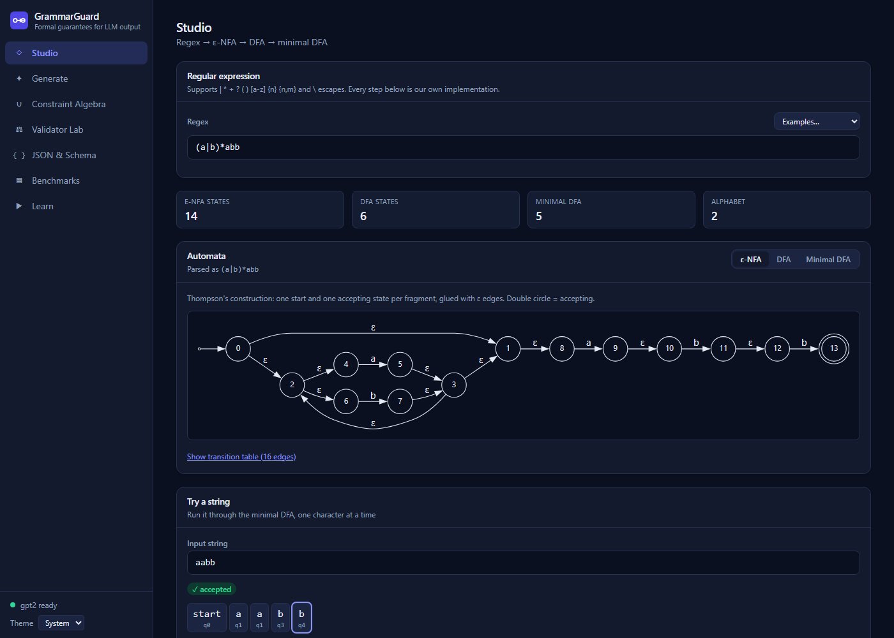

**Say.** "I type a rule. First my parser turns it into an ε-NFA by Thompson's construction: 14 states with free ε moves. Then subset construction
converts it to a deterministic machine of 6 states. Then table-filling minimization merges equivalent states down to 5. Every algorithm is
my own code, no library."

**Theory.** Thompson's construction (regex → ε-NFA), ε-closure, subset construction (NFA → DFA), DFA minimization (Myhill–Nerode). The 6 and 5 include one
hidden *dead state*, which is why the drawing shows 4 circles on the minimal tab.

**Then scroll to "Try a string".** Type each string below into **Input string** and read the result:

| Type | Result | What to say |
|---|---|---|
| `aabb` | **✓ accepted**, path q0 → q1 → q1 → q3 → q4 | "Ends in the winning square." |
| `babb` | ✓ accepted | "Any a/b mix, ending in abb." |
| `abab` | ✗ rejected, but badge says **"valid prefix: could still be completed"** | "Not finished: it could become valid by adding `b`." |
| `ab` | ✗ rejected, valid prefix | same idea |
| `abx` | ✗ rejected, badge **"no completion exists after character 3"** | "`x` is not in the alphabet: the machine falls into the trap." |

Drag the slider under the letters to walk the machine one letter at a time. The graph highlights the current square.

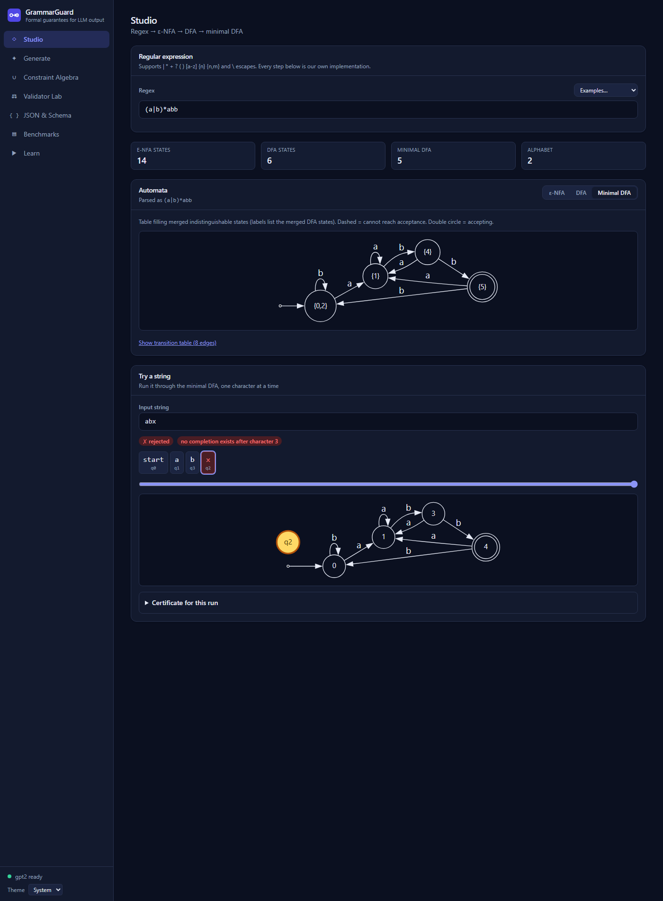

In this picture the **yellow circle `q2` floating on its own is the dead state**. The numbers in this lower graph (0, 1, 3, 4) are the state *numbers*
used in the letter boxes; the labels in the upper graph (`{0,2}`…) show merged states. Both describe the same machine.

**Optional.** Open **Certificate for this run** → click **Verify certificate** to see the receipt checked (explained in Step 3).

**Show error handling (30 seconds).** In the regex box replace the text with `ab(c`. You get a red message with a caret under the problem:

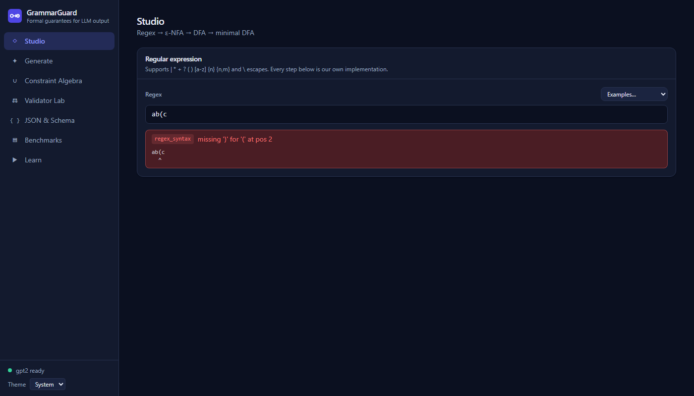

**Say.** "The error names the exact position. The same message comes from the server API, with a numeric position, so other programs can use it."
Put `(a|b)*abb` back (or use the Examples menu).

---

### Step 2. Learn: watch the algorithms run (3 minutes)

**Type/click.** Open **Learn**. It uses `(a|b)*abb`. You start on **Subset construction**. Click **▶ Play**, or press the **▶** next-step button.

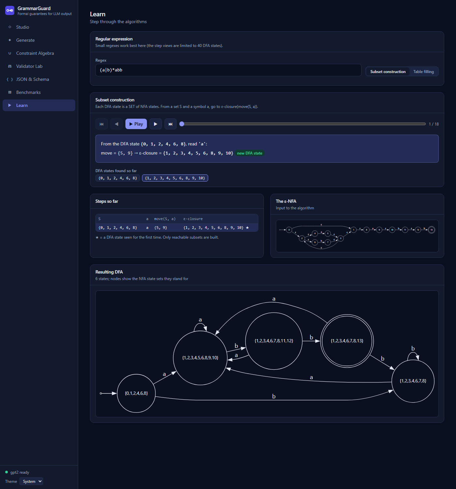

**What you will see.** One *step* at a time: "From the DFA state {0,1,2,4,6,8}, read 'a': move = {5,9}, ε-closure = {1,2,3,4,5,6,8,9,10}, new DFA state."
There are **18 steps** (6 DFA states × the letters a, b, and "any other character"). A table lists the steps so far, and the ε-NFA and the final DFA are drawn.

**Say.** "Each DFA state is a *set* of NFA states: all the places the NFA could be at once. This is subset construction, recorded from the real algorithm, not an animation."

Now click **Table filling**, then **⏭ (last step)**.

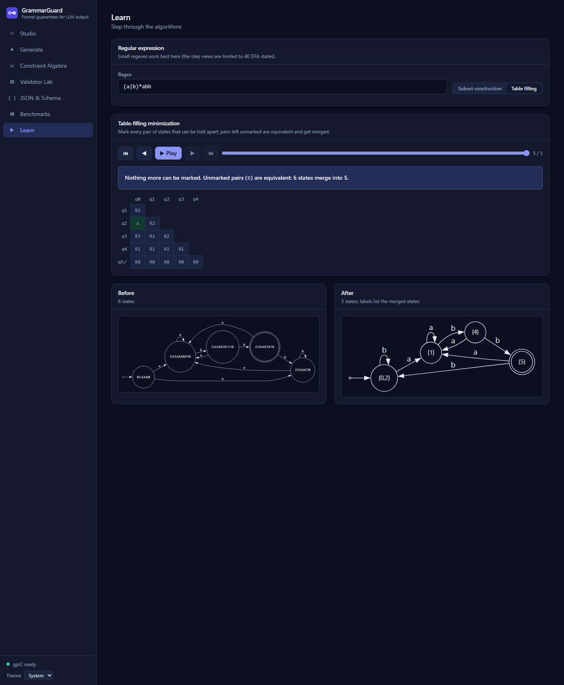

**What you will see.** A triangle of cells, one per pair of states. `R0` = marked in round 0, and so on. The green **≡** marks the one pair that was never told apart.
The text says "6 states merge into 5". Round 0 marks 5 pairs (one state is accepting, the others are not), round 1 marks 4, round 2 marks 4, round 3 marks 1: 14 of 15
pairs. The unmarked pair is q0 and q2, which become the circle `{0,2}`.

**Say.** "Two states are 'distinguishable' if some continuation accepts from one and not the other. Round by round I mark such pairs. What is never marked is equivalent
and gets merged. That is the table-filling algorithm and the Myhill–Nerode idea."

**Theory.** Subset construction; table-filling minimization.

---

### Step 3. Generate: the main event (5 minutes)

**Type/click.** Open **Generate**. In **Examples…** choose **ISO date**. Leave the other settings. Press **Generate**.


**What you will see (left to right, top to bottom).**
1. **Setup card:** the rule (`[0-9]{4}-[0-9]{2}-[0-9]{2}`), the prompt (`Date: `), how many tokens, sampling options, and the box "Also run without the constraint".
2. **Unconstrained card** (red "✗ no match"): what GPT-2 writes by itself: ` January 1, 2014 The first of the three new episodes…`. A fluent sentence, but not a date in our format.
3. **Constrained card** (green "✓ matches"): `2019-01-01`, shown as five coloured chips `2019` `-` `01` `-` `01`. Orange shading = how hard the rule pushed on that token.
   "Stopped: model chose to stop (end-of-text, only allowed in an accepting state)".
4. **Four number boxes:** Tokens 5, Total cost **9.11 bits**, Mean pressure **27.2%**, Overrides **1**.
5. **Constraint pressure chart:** one bar per token. The tall first bar is the `2019` token, and the red dot underneath means "the AI's own first choice was not allowed".
6. **Step details** for the selected chip (click `2019`): DFA state after **q5**; Allowed tokens **981 of 50,257**; Probability kept **0.3%**; Information cost **8.50 bits**;
   Model's first choice **blocked**.
7. **Automaton:** the machine as a chain of squares; the yellow one is where the text is now.
8. **Certificate** (next).

**Say.** "On its own GPT-2 writes a sentence. With the rule, at the first step only digit-pieces are allowed (981 of 50,257 tokens). The AI's real first choice was a
blank (a non-breaking space), which the rule blocked, and that cost 8.5 bits. After `2019` only `-` is allowed (1 option), then two digits (110 options)… The output is *guaranteed* to match."

**Theory.** The token ↔ DFA bridge: for each state and token, run the DFA over the token's characters; keep it if the end state is *live*.

**Click `Verify certificate`.**

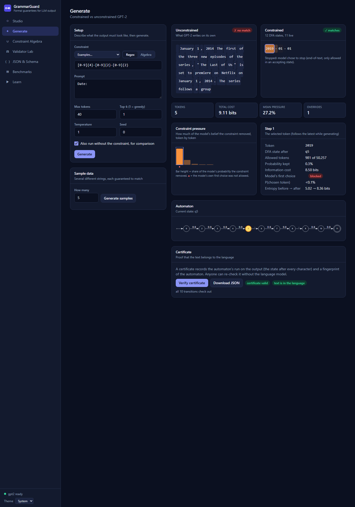

You get **certificate valid** and **text is in the language**, "all 10 transitions check out".

**Say.** "The certificate is a receipt: the machine's square after each of the 10 characters, plus a fingerprint of the machine. The server rebuilds the machine from the rule
and replays the receipt without the AI. 'Valid' means the receipt is honest; 'in the language' means the text matches."
(You can also press **Download JSON** and show the file.)

#### Step 3b. When the AI fights the format (2 minutes)

This shows that the cost number means something. Change the rule box to `EMP-[0-9]{3,5}` and the prompt to `Employee ID: `, then **Generate**.


**What you will see.** Constrained output `EMP-1123`, but **57.20 bits**, **86.8% pressure**, **4 overrides**. The unconstrained text is `(1) Employee ID: (2) Employee ID: …`.

**Say.** "GPT-2 had no idea what an employee ID looks like, so the rule had to overrule it four times: 57 bits of 'force'. Compare this with a prompt that already shows the format."

#### Step 3c. When the AI already wants to comply (2 minutes)

Click **Algebra** (next to Regex). In the rule box type `email & !contains(/spam/) & length(8, 30)`. Set the prompt to
`Staff contacts: ann.lee@corp.com, raj@corp.com, ` and set **Top-k** to `20`. Press **Generate**.

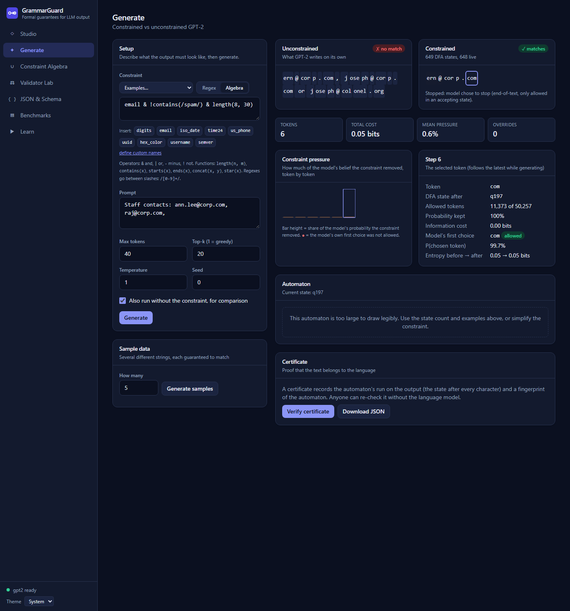

**What you will see.** Output `ern@corp.com`, total cost **0.05 bits**, mean pressure **0.6%**, **0 overrides**. "649 DFA states". The automaton box says it is too large to draw.

**Say.** "Same rule, but now the prompt shows examples, so GPT-2 already wanted an email. The rule barely had to do anything: 0.05 bits. The cost measures *disagreement between the AI and the rule.*
The same rule with a bare prompt `Contact: ` and greedy decoding costs about 38 bits and produces `__________.__.__.__.__.__@r.rj`, which is valid but silly, because the
rule allows underscores and dots."

#### All six built-in examples (greedy, default settings)

These are what you will get if you pick each item in **Examples…** and press Generate (results are deterministic; tiny differences are possible on a different computer):

| Example | Prompt | Constrained output | Tokens | Cost (bits) | Pressure | Overrides |
|---|---|---|---|---|---|---|
| ISO date | `Date: ` | `2019-01-01` | 5 | 9.11 | 27% | 1 |
| US phone number | `Phone: ` | `(800) 622-9000` | 8 | 11.89 | 14% | 1 |
| Employee ID | `Employee ID: ` | `EMP-1123` | 6 | 57.20 | 87% | 4 |
| Boolean-ish word | `Value: ` | `false` | 1 | 16.72 | 100% | 1 |
| Email, no spam, 8–30 chars | `Contact: ` | `__________.__.__.__.__.__@r.rj` (valid, but ugly: see 3c) | 17 | 38.43 | 52% | 8 |
| Time that is not midnight | `Meeting at ` | `00:30` | 3 | 15.24 | 79% | 2 |

**Tip:** for the email example, show the **3c** version (few-shot prompt, Top-k 20) instead of the default, because its output looks natural.

#### Step 3d. Several valid samples (30 seconds, optional)

In the **Sample data** card press **Generate samples**. You get five *different* strings, each guaranteed to match, with their cost in bits.
"Useful as test data for a validator."

---

### Step 4. Constraint Algebra: combining rules (4 minutes)

**Type/click.** Open **Constraint Algebra**. It contains `email & !contains(/spam/) & length(8, 30)` ("an email address that does not contain the word spam and is 8 to 30 characters long").


**What you will see.**
- **Expression box** with clickable names to insert (`digits`, `email`, `iso_date`, …) and a one-line reminder of the operators:
  `&` and, `|` or, `-` minus, `!` not; functions `length`, `contains`, `starts`, `ends`, `concat`, `star`; regexes go between slashes.
- **Four number boxes:** **649** minimal states, **648** live, language **finite**, **3.62 × 10^45** strings (exactly counted; the actual number has 46 digits).
- **"Equivalent regular expression":** says the automaton has 649 states so a regex would be impractically large (it is shown for small ones: see below).
- **"How it was built":** the construction steps: `email` (12 states) → `/spam/` (6) → `contains(/spam/)` (5) → `!contains(/spam/)` complement (5) → `email & !contains` intersection (33) → `length(8,30)` (32) → final intersection (**649**).
- **"Strings in the language":** the shortest valid strings (they begin with `...@0.aa`; the dots stand for any allowed character) and a bar chart of how many valid strings exist at each length (6,236,634,024 of length 8; 3.92 × 10^16 of length 12).
- **Automaton:** "too large to draw legibly" (649 states).

**Say.** "Each operator is a construction from the course. `&` is the **product construction**; `!` is **complement**: swap accepting and non-accepting squares;
`contains` is concatenation. The page lists each step and the size of the machine after it. The final machine has 649 states and accepts exactly 3.6 × 10^45 strings, and
I can count them without listing them, by dynamic programming over the machine."

**Theory.** Closure of regular languages under intersection, union, difference, complement, concatenation, star. Counting by dynamic programming. Finiteness test.

**A small example where you can see everything.** Replace the expression with: `digits & !/0[0-9]*/ & length(2, 4)` ("2 to 4 digits, not starting with 0").
You get **6 states**, **9,990** strings (90 + 900 + 9,000), and an **equivalent regular expression `[1-9][0-9]([0-9][0-9]?)?`** with a **Copy** button, and a small drawn machine.

**Say.** "Kleene's theorem, other direction: the machine converted back into a regex by *state elimination*."

**Equivalence: are two rules the same?** Scroll to **"Compare with another constraint"**. Set the expression at the top to `/(a|b)*/` (regexes go between slashes) and the *other constraint* box (Regex) to `(a*b*)*`, then **Compare**:
**"Equivalent: both define exactly the same language"**.

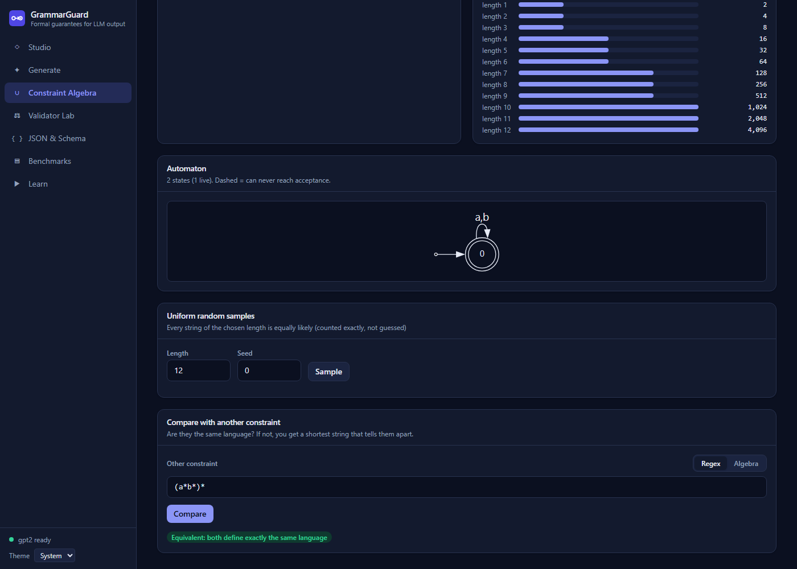

Change the other constraint to `(a|b)*a` and **Compare**:

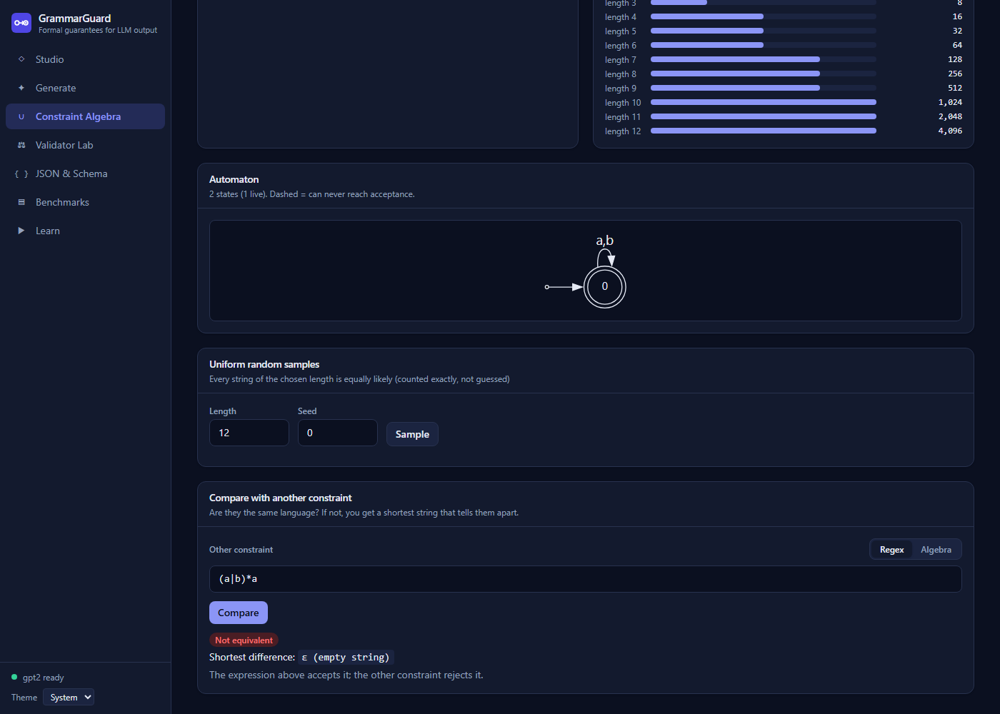

**What you will see.** "Not equivalent. Shortest difference: ε (empty string). The expression above accepts it; the other constraint rejects it." (The first rule accepts the empty string; the second needs a final `a`.)

**More pairs to try:**

| Top expression | Other constraint | Result |
|---|---|---|
| `/(a\|b)*abb/` | `(a\|b)*bb` | not equivalent, shortest difference `bb` (the other accepts it; the top one rejects it) |
| `/a+/` | `aa*` | equivalent |
| `/[0-9]{2}/` | `[0-9]{2,3}` | not equivalent, shortest difference `000` |

**Say.** "Two rules are equivalent if no string is accepted by one and not the other. I build the machine for 'accepted by exactly one of them' (a product construction) and search for its shortest accepted string with breadth-first search. If there is none, they are equivalent. If there is, it is a *shortest counterexample*."

**Uniform random samples.** In **Uniform random samples** press **Sample** (length 12). You get 8 random valid strings, each equally likely because the machine's paths are counted exactly.

---

### Step 5. Validator Lab: comparing and testing rules (4 minutes)

**Type/click.** Open **Validator Lab**. The two boxes are pre-filled: **Old** `[0-9]{3}-[0-9]{2}` and **New** `[0-9]{3}[-_][0-9]{2}` ("the new one also allows an underscore as a separator"). Press **Compare validators**.


**What you will see.** The headline **"New validator is looser"**, an explanation ("Inputs that used to be rejected will now be accepted. Check for security or data-quality impact"), and three lists:
- *Only the OLD accepts*: none.
- *Only the NEW accepts* (shortest first): `000_00`, `000_01`, `000_02`, …
- *Both accept*: `000-00`, `000-01`, …

"Found by search over the product automaton (8 and 8 states)."

**Say.** "A developer changes a form rule from dash-only to dash-or-underscore. This tells them exactly what changed, with example strings, before the change ships. It uses the same set operations:
old minus new is empty, new minus old is not."

**Theory.** Closure under difference; emptiness testing; shortest strings by BFS.

**Test-suite generation.** Press **Generate test suite**.

**What you will see.** **123** test cases, **100% transition coverage**, 47 that should be accepted and 76 that should be rejected, filter buttons (boundary 53, transition 47, truncation 5, deletion 3, substitution 15),
and a table with a *reason* for every case (for example "valid up to position 0, then `-`").

**Say.** "Every arrow of the machine is exercised by a valid string (100% coverage), and for the invalid ones I try the typical mistakes: breaking right after a valid start, swapping a character for a space or underscore, leaving one out, stopping early."

**Make it real (this is a great moment).** Click **Download pytest file**. In the terminal:

```bash
cd ~/Downloads        # or wherever the browser saved test_validator.py
python -m pytest -q test_validator.py
```

Result: **123 passed** against the new validator. Now edit the first lines to the **old** rule, `PATTERN = '[0-9]{3}-[0-9]{2}'`, and run it again: **1 failed, 122 passed**, the failure
is `000_00` (expected valid, but the old rule rejects it). **Say.** "The generated suite catches the change."
(This exact experiment was run on the real system: 123 passed, then exactly 1 failure.)

---

### Step 6. JSON & Schema: the stack (4 minutes)

**Type/click.** Open **JSON & Schema**. Mode **Schema** is selected with a sample schema (a person with name, age, role, tags, active). Press **Generate**.

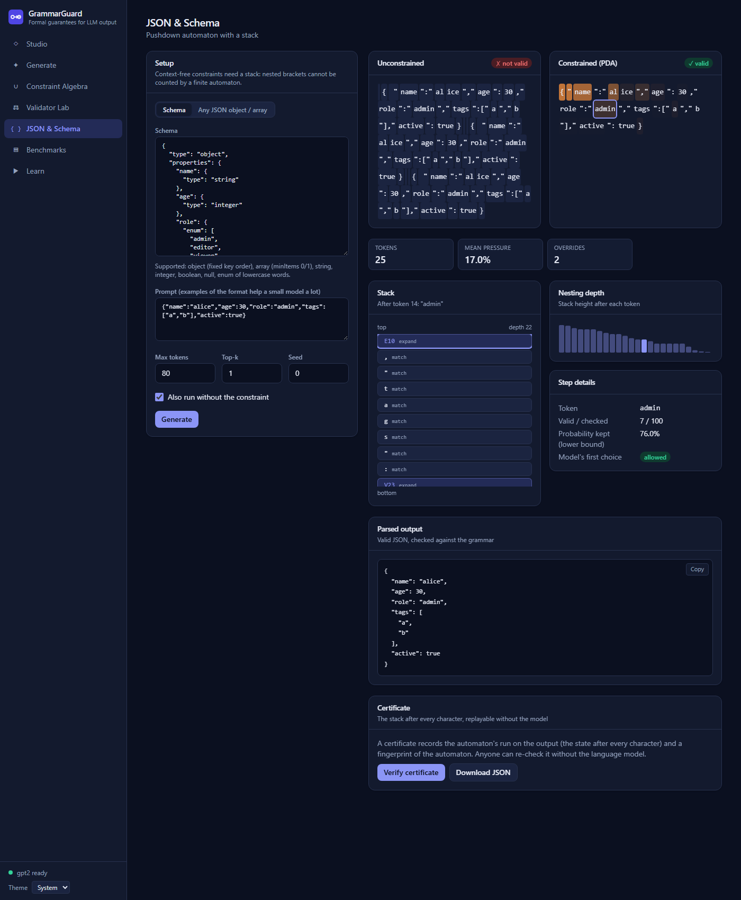

**What you will see.**
- **Unconstrained** (red "✗ not valid"): repeated JSON-looking text with spaces after colons and several objects in a row (our grammar forbids those).
- **Constrained (PDA)** (green "✓ valid"): `{"name":"alice","age":30,"role":"admin","tags":["a","b"],"active":true}` in 25 tokens. Mean pressure **17.0%**, **2** overrides.
- **Stack card:** click a chip such as `admin`. It shows "After token 14: `admin`", depth **22**, and the stack top-first: `E10 expand`, then `, match`, `" match`, `t match`, `a match`, `g match`, `s match`, `" match`, `: match`, `V23 expand`.
  *expand* = a rule still to be unfolded; *match* = a character the text must still produce. Click the last chip and the stack says **"Stack empty: the document is complete."**
- **Nesting depth chart**, **Step details** (e.g. "Valid / checked 7 / 100" = 7 of the AI's top-100 choices were valid).
- **Parsed output**: the JSON pretty-printed, proving it parses.

**Say.** "JSON nests, so a finite machine is not enough. This is a pushdown automaton built from an LL(1) grammar. The schema I typed was *compiled into a grammar*, so the output has the right keys in the right order and the right types, not just valid brackets. The stack shows what the machine still owes."

**Theory.** Context-free grammars; FIRST/FOLLOW; LL(1) parse table; deterministic pushdown automaton; why regular languages cannot do nesting (pumping lemma).

**Try it live.** Edit the schema (for example change `"role"` values) and press **Generate** again. The page refuses invalid schemas before sending anything.

---

### Step 7. Benchmarks: the evidence (3 minutes)

**Type/click.** Open **Benchmarks** (no model needed).


**What you will see.** Five bars with whiskers (95% confidence intervals), from top:

| Method | Output satisfies the rule |
|---|---|
| Plain GPT-2, as is | **0%** (0–3%) |
| Plain GPT-2 + extract a valid prefix | 11% (6–18%) |
| Best-of-5 retries, as is | 3% (1–10%) |
| Best-of-5 retries + extract a valid prefix | 17% (10–27%) |
| **GrammarGuard** | **100%** (97–100%), 108 of 108 runs |

Cards: **1.34×** (slower per token than plain decoding), **16.9 bits** (average cost), **5.0** (retries needed: it almost always used all 5), **agree** (our machine and Python's own `re` agree on every output).
Then a table by category and a table for every one of the 18 rules (state count, how long building the index takes, and the three success rates).

**Say.** "288 runs over 18 realistic formats (dates, phone numbers, IDs, emails, combined rules), with two prompts each, including one that shows the AI examples. I compared fairly: the weakest baseline is plain GPT-2 judged strictly, and I also gave the baselines two kinds of help: retrying five times and rescuing a valid prefix from the output.
Even so the best baseline reaches 17%. GrammarGuard is 100%, at only 1.34 times the time per token."

**Be honest about it.** GPT-2 is a *small* model; a larger model would do better on its own. "Read the gap as 'GPT-2 cannot be trusted with these formats', not as a universal number." Also: my first benchmark had unfair prompts, which I found, fixed and re-ran (recorded in `DECISIONS.md`). Teachers like hearing this.

**Audit the raw outputs.** Scroll to **"Audit the raw outputs"**, choose a validator, and show the actual text produced by each method:

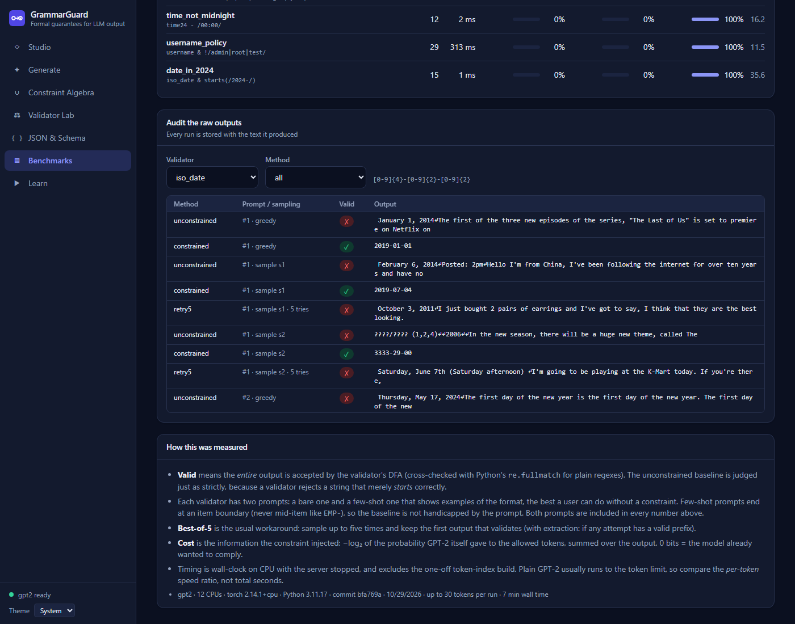

"Nothing is hidden: every one of the 288 runs and its text is stored and viewable."

---

### Step 8. Under the hood (3 minutes)

**The API.** Open **http://localhost:8000/docs**. All 17 operations are listed and can be tried from the page.

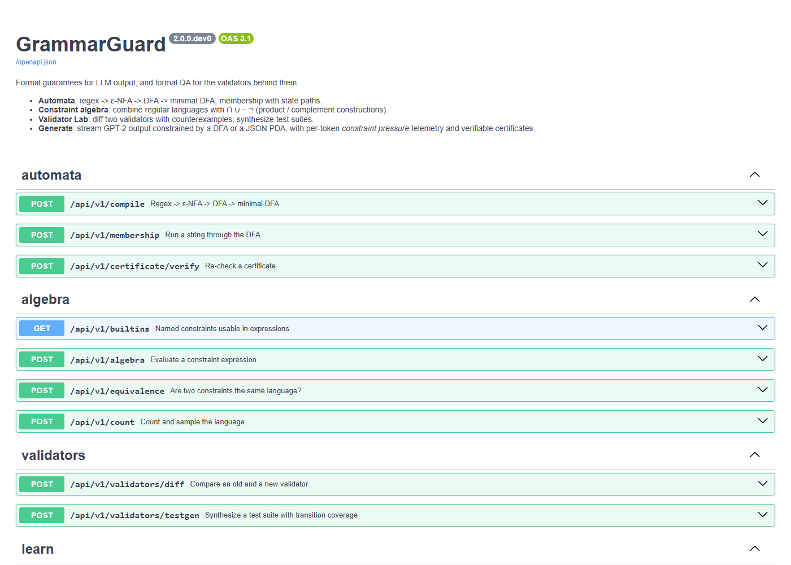

**Say.** "The website is a client of this API. Everything shown can be done by a program."

**The command line.**

```bash
.venv/bin/python -m grammarguard.cli --regex "[0-9]{4}-[0-9]{2}-[0-9]{2}" --prompt "Date: " --verbose
```

```
regex: [0-9]{4}-[0-9]{2}-[0-9]{2}   minimal DFA: 12 states, 11 live

unconstrained [max_tokens]: ' January 1, 2014\nThe first of the three new episodes ...'
  matches regex: False

constrained   [eos]: '2019-01-01'
  matches regex: True   (0.6s)
  '2019'       -> state 5   allowed=981
  '-'          -> state 6   allowed=1
  '01'         -> state 8   allowed=110
  '-'          -> state 9   allowed=1
  '01'         -> state 11  allowed=110
```

**The tests.**

```bash
make test-fast     # all tests that do not load GPT-2 (about half a minute)
make test          # everything: 401 Python tests (about 80 s), plus:
cd frontend && npm test    # 34 frontend tests
```

**Say.** "401 Python tests and 34 frontend tests. My automata are tested against Python's own `re` module on thousands of random strings, and the JSON machine against Python's `json` module."

**The code map** (if the teacher says "show me the code for X"):

| Teacher asks about | Open this file |
|---|---|
| Regex parsing | `grammarguard/core/regex_parser.py` |
| NFA, Thompson, ε-closure | `grammarguard/core/nfa.py` |
| Subset construction, minimization, product, complement, equivalence | `grammarguard/core/dfa.py` |
| Combining rules (`&`, `!`) | `grammarguard/core/algebra.py` |
| DFA → regex | `grammarguard/core/elimination.py` |
| Counting, sampling | `grammarguard/core/counting.py` |
| Test generation | `grammarguard/core/testgen.py` |
| Grammars, LL(1) table | `grammarguard/core/cfg.py` |
| Pushdown automaton | `grammarguard/core/pda.py` |
| Constraining GPT-2 | `grammarguard/decoding/token_index.py` and `generate.py` |
| Certificates | `grammarguard/core/certificate.py` |

Every function has a comment that says which theory step it implements.

---

## Part 4: Presenting to the teacher

### 4.1 Opening (30 seconds, say it out loud)

> "AI language models often ignore formats. My project makes a model's output *provably* match a format. I built the underlying theory myself: from a regular expression to an NFA with Thompson's construction,
> to a DFA with subset construction, then minimization, closure operations, equivalence checking and a pushdown automaton for JSON. Then I connect those machines to GPT-2 so it can only choose tokens that keep the text valid.
> I'll show the theory first, then the AI, then what the theory makes possible."

### 4.2 Order and timing

**10-minute plan**

| Minutes | Step | Why this one |
|---|---|---|
| 0:00–0:30 | Opening | |
| 0:30–3:00 | Step 1 Studio (the three tabs, `aabb`, `abx`) | shows regex → NFA → DFA → minimal |
| 3:00–6:00 | Step 3 Generate (ISO date, then verify certificate) | the main result |
| 6:00–7:30 | Step 4 Algebra (default expression; equivalence pair) | closure + equivalence |
| 7:30–8:30 | Step 5 Validator Lab (compare) | practical use |
| 8:30–9:30 | Step 7 Benchmarks (read the five bars) | evidence |
| 9:30–10:00 | Closing | |

**20-minute plan:** everything in order 1 → 8. Spend the extra time on Step 2 (Learn), Step 3b/3c (cost story), Step 5 (pytest experiment) and Step 6 (JSON stack).

### 4.3 Mapping to what the course covers

| Course topic | Where to show it |
|---|---|
| Regular expressions | Studio (input box, parsed form) |
| NFA with ε-moves, ε-closure | Studio ε-NFA tab; Learn subset steps |
| NFA → DFA (subset construction) | Studio DFA tab; Learn |
| DFA minimization | Studio minimal tab; Learn table |
| Dead / live states, emptiness | Studio "Try a string" (`abx`) |
| Closure properties | Constraint Algebra "How it was built" |
| Equivalence / decision problems | Algebra "Compare with another constraint"; Validator Lab |
| Kleene's theorem (DFA → regex) | Algebra small example (`[1-9][0-9]([0-9][0-9]?)?`) |
| Pumping lemma (why JSON needs a stack) | JSON page, stack |
| Context-free grammars, LL(1), PDA | JSON & Schema |
| Applications | Generate, Validator Lab, Benchmarks |

### 4.4 Closing (30 seconds)

> "To summarise: it takes a rule, builds the machines with the algorithms from the course, and uses them to make GPT-2 follow the rule *with a guarantee*. Plain GPT-2 satisfied the rules 0% of the time in my benchmark, and the guaranteed version 100%,
> measured on 288 runs. And because I own the machines, I also get rule comparison with counterexamples, automatic test suites, exact counting and re-checkable certificates."

### 4.5 Limitations to mention *before* they ask

- The model is small (GPT-2): the **format** is guaranteed; the **content** is only as good as the model (see the silly email in Step 3).
- The JSON subset is simple: no spaces, lowercase text, no negative numbers.
- The rule syntax does not include `.`, `^`, `$`, `[^…]` (see `DECISIONS.md` for why).
- Not built: Chomsky/Greibach normal forms, CYK, pumping-lemma tooling, linear bounded automata, Post correspondence problem.
- The Docker packaging is written but was never built on this computer.
- The benchmark is for GPT-2 only.

---

## Part 5: Questions you may be asked (plain answers)

More are in `docs/VIVA.md`.

**"What exactly is a regular expression?"** A short way to write a pattern of text. `[0-9]{4}` means four digits. Every regular expression can be turned into a state machine.

**"What is the difference between an NFA and a DFA?"** In a DFA each square has exactly one arrow per character, so you always know where you are. An NFA may have several choices, plus free moves. They can express exactly the same patterns, and subset construction converts an NFA into a DFA.

**"Why do you need a DFA, not the NFA?"** To decide quickly which tokens are allowed we must know the *one* current state. A DFA gives that.

**"What does 'live' mean and why does it matter?"** A state is live if a valid ending is still reachable. We only allow tokens that keep us live, so the text can always be completed, and the AI never gets stuck.

**"How can you guarantee the output matches?"** Because every token we allow keeps the machine live, and the AI may only stop on an accepting square. So whenever it stops, the text ends on a winning square: that is, it matches. (`docs/THEORY.md`, section 11.)

**"What if the AI cannot find any allowed token?"** With GPT-2 that cannot happen for normal text rules, because GPT-2 has a token for every single character; from a live square at least one such token is always allowed.

**"What is 'constraint pressure' or 'bits'?"** How much probability the AI gave to the tokens we removed. If the AI put 99.9% on allowed tokens, the rule cost almost nothing (0.001 bits). If it put 0.3% on them, the rule cost 8.5 bits. It is measured in bits: −log₂ of the probability of what was allowed.

**"Why is it 1.34 times slower?"** Because for each token we apply the allowed list and compute the statistics. The expensive part (working out which tokens each state allows) is done once and cached.

**"Isn't this what the libraries Outlines or llama.cpp already do?"** The core idea of constraining generation is similar and I do not claim it is new. What I built on top: combining rules with closure properties, comparing validators with counterexamples, test generation, exact counting, certificates, the cost metric and a measured benchmark, all on my own machines.

**"Is the benchmark fair?"** I gave the baselines the best prompt I could, a retry strategy, and a trick to extract a valid prefix. I cross-checked every judgement with Python's `re`. My first version was unfair (prompts that ended mid-word), which I found, fixed and re-ran. The model is small, so the gap would be smaller for a big model.

**"What was the hardest bug?"** A function that listed the shortest valid strings tried every possible beginning one by one; for a rule with long matches that is billions of strings and it crashed my computer several times. I replaced it with a table of "which squares can still finish in exactly *k* more characters", so it follows only paths that succeed (4.5 milliseconds).

---

## Part 6: All the examples in one place

### 6.1 Rules for Studio / Learn (type into the Regex box)

| Rule | What it means | Try these strings |
|---|---|---|
| `(a\|b)*abb` | any a/b mix ending in `abb` | `abb` ✓, `aabb` ✓, `abab` ✗ (prefix ok), `abx` ✗ (dead) |
| `[0-9]{4}-[0-9]{2}` | four digits, dash, two digits | `2024-05` ✓, `20x4-05` ✗ (dies at char 3), `2024-` ✗ (prefix ok) |
| `EMP-[0-9]{3,5}` | `EMP-` and 3 to 5 digits | `EMP-042` ✓, `EMP-12` ✗ |
| `(true\|false\|null)` | one of three words | `true` ✓, `tru` ✗ (prefix ok) |
| `a*` | any number of a's | `` ✓ (empty), `aaa` ✓, `ab` ✗ |
| `ab(c` | **deliberate error** | red message with a caret at position 2 |
| `a.b` | **deliberate error**: `.` is not supported | "'.' is not supported; escape it as '\.'" |
| `(a\|b)*a(a\|b){20}` | **deliberate "too big"**: needs about 2 million states | refused, "would need more than 5000 states" (this is a safety limit of the server) |

### 6.2 Expressions for Constraint Algebra

| Expression | Result to expect |
|---|---|
| `email & !contains(/spam/) & length(8, 30)` | 649 states, finite, 3.62 × 10^45 strings |
| `digits & !/0[0-9]*/ & length(2, 4)` | 6 states, 9,990 strings, regex `[1-9][0-9]([0-9][0-9]?)?` |
| `/[ab]{3}/` | 8 strings, all of length 3 |
| `time24 - /00:00/` | every 24-hour time except midnight |
| `iso_date & starts(/2024-/)` | dates in 2024 |
| `username & !/admin\|root\|test/` | usernames that are not reserved words |
| `!/a/` | "everything except the string a": shows that no regex can be written for it (message explains why) |

Built-in names you can use inside expressions (click the buttons under the box): `digit`, `digits`, `lower`, `upper`, `word`, `alnum`, `integer`, `decimal`, `iso_date`, `time24`, `email`, `us_phone`, `intl_phone`, `zip_us`, `hex_color`, `uuid`, `ipv4_shape`, `username`, `slug`, `semver`.

### 6.3 Equivalence pairs

| First (use slashes in the Algebra box) | Other | Verdict |
|---|---|---|
| `/(a\|b)*/` | `(a*b*)*` | equivalent |
| `/(a\|b)*/` | `(a\|b)*a` | not equivalent; shortest difference ε (empty string) |
| `/(a\|b)*abb/` | `(a\|b)*bb` | not equivalent; `bb` |
| `/a+/` | `aa*` | equivalent |
| `/[0-9]{2}/` | `[0-9]{2,3}` | not equivalent; `000` |

### 6.4 Validator Lab pairs

| Old | New | Verdict |
|---|---|---|
| `[0-9]{3}-[0-9]{2}` | `[0-9]{3}[-_][0-9]{2}` | new is **looser**; only-new starts `000_00` |
| `[0-9]{2,3}-[0-9]{2}` | `[0-9]{3}-[0-9]{2}` | new is **stricter** |
| `a[ab]*` | `[ab]*b` | behaviour changes **both ways** |
| `a+` | `b+` | **completely different** (disjoint) |
| `[0-9]{3}-[0-9]{2}` | same | **equivalent** |

### 6.5 Generate examples (the six built-ins + two extras)

See the table in Step 3 and the two extra runs in 3b and 3c.

---

## Part 7: If something goes wrong

| Problem | What to do |
|---|---|
| Page does not open | Check the terminal running the server is still alive; try `http://127.0.0.1:8000`. Restart with the command in 2.1. |
| Sidebar says "Server offline" | The server stopped. Restart it. |
| Sidebar says "Loading gpt2…" for a long time | Wait up to a minute (first start). If it never finishes, show the **Benchmarks**, **Studio**, **Algebra** and **Validator Lab** pages, which do not need the model, and use the screenshots in `docs/img/` for Generate and JSON. |
| Generate is slow | Normal for the first run. Show something else for a few seconds. Lower **Max tokens** to 20. |
| Output differs from this guide | The numbers in this guide are for greedy decoding on the same model; a different CPU or library version can change a token. Explain the idea, not the exact digits. If **Top-k** is greater than 1 the output is random by design. |
| "Another generation is running; yours is queued" | Only one generation runs at a time. Wait, or press **Stop** on the other tab. |
| You typed something and the page shows a red error | That is a feature: read the message and the caret to the teacher. |
| Everything fails | Show the screenshots in `docs/img/` in the order of Part 3, and the code map in Step 8. |

### Quick reset

Stop the server with `Ctrl+C` in its terminal, start it again (2.1), and reload the page.

---

## Appendix: the screenshots used in this guide

All are in `docs/img/`.

| File | Shows |
|---|---|
| `studio.png`, `studio-nfa.png` | the machines for `(a\|b)*abb` |
| `studio-reject.png` | the string `abx` falling into the dead state |
| `studio-error.png` | a syntax error with a caret |
| `learn.png`, `learn-table.png` | subset construction; table filling finished |
| `generate.png`, `generate-verified.png` | ISO date; certificate verified |
| `generate-fights.png`, `generate-fewshot.png` | high cost (Employee ID) vs near-zero cost (email with examples) |
| `algebra.png`, `algebra-equal.png`, `algebra-diff.png` | the email policy; two equivalence checks |
| `validators.png` | old vs new validator and the test suite |
| `json.png`, `json-stack.png` | JSON generation; the stack at token 14 |
| `benchmarks.png`, `benchmarks-audit.png` | the results; the raw-output audit |
| `api-docs.png` | the interactive API documentation |
